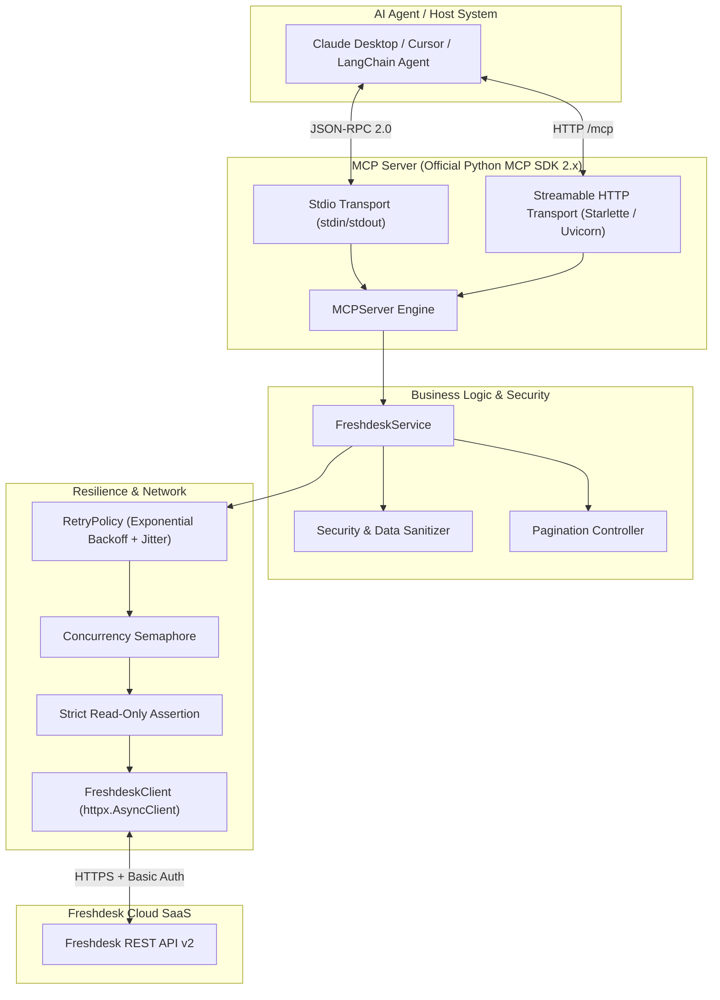

# System Architecture & Technical Design

The **Freshdesk MCP Connector** is built with a layered, decoupled architecture conforming to the official Model Context Protocol (MCP) specification.

---

## 1. End-to-End Component Diagram

---

## 2. Layer Responsibilities

### 2.1 Transport Layer (`server.py`)
- **Dual Transport Support:** Implements both `stdio` and `streamable-http`.
- **Stdio Safety:** Routes all logging to `sys.stderr` so that `stdout` is never corrupted by diagnostic output.
- **Streamable HTTP:** Mounts a high-performance Starlette ASGI app served by Uvicorn. Emits security warnings when bound to non-localhost addresses without TLS termination.
- **Lifecycle Management:** Handles `SIGINT` and `SIGTERM` signals, cancelling in-flight tasks and closing HTTP client connections cleanly.

### 2.2 Tools & Validation Layer (`tools/`, `schemas.py`)
- Defines strong Pydantic schemas for tool inputs and outputs.
- Translates API errors into safe, structured JSON dictionaries (`ErrorResponse`) so AI agents receive machine-readable error codes rather than unhandled exception traces.
- Enforces tool-level parameter validation (e.g. `ticket_id > 0`, query length $\le$ 500 characters).

### 2.3 Service Orchestration Layer (`freshdesk_service.py`)
- Coordinates data retrieval and response normalization.
- Maps internal Freshdesk numeric constants (`status: 2`, `priority: 3`) to human-readable strings (`Open`, `High`).
- Sanitizes untrusted text strings and limits character lengths.
- Injects `data_safety_notice` metadata into every response.

### 2.4 Resilient Network Layer (`freshdesk_client.py`, `retry.py`)
- Manages an asynchronous connection pool with `httpx.AsyncClient`.
- Implements HTTP Basic Authentication with API key.
- **Strict Read-Only Enforcement:** Physically blocks any non-GET request before it leaves the connector.
- **Adaptive Rate Limiting:** Detects HTTP 429 and parses `Retry-After` headers (both integer seconds and RFC 2822 timestamps).
- **Exponential Backoff with Full Jitter:** Prevents retry storms on transient 5xx or network errors.
- **Concurrency Limiting:** Bounds simultaneous outbound requests using an `asyncio.Semaphore`.
